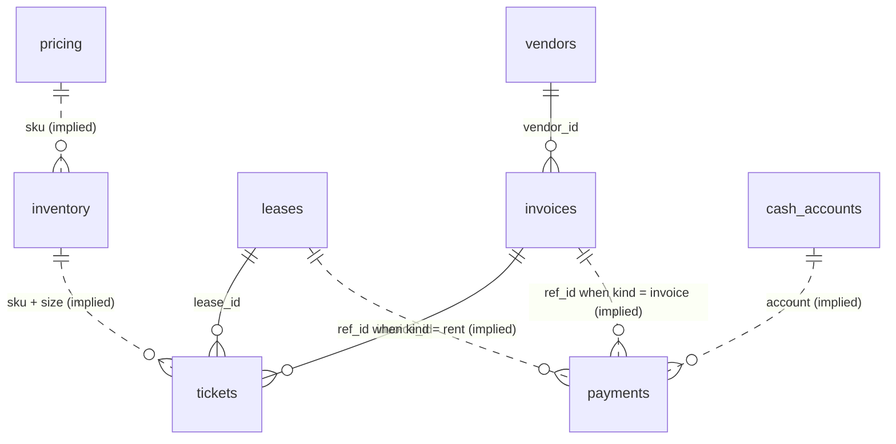
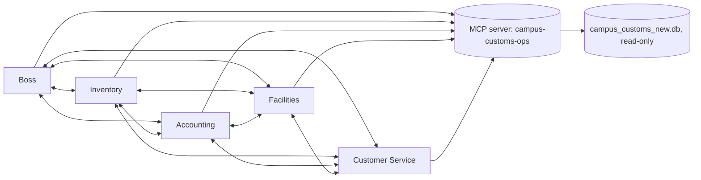
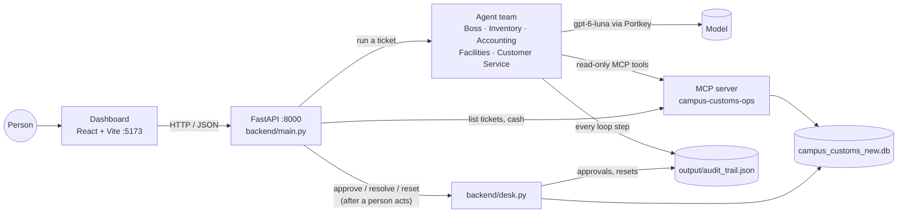

# Campus Customs Operations — Harness

The harness of the Campus Customs multi-agent operations system: what the agents can see, use and change. Sections are added as the system is built.

## Contents

1. [Database](#1-database)
2. [MCP server tools](#2-mcp-server-tools)
3. [Agent team](#3-agent-team)
4. [Audit trail](#4-audit-trail)
5. [Safety](#5-safety)
6. [Limits on token use](#6-limits-on-token-use)
7. [Backend routes](#7-backend-routes)
8. [Final system](#8-final-system)

## 1. Database

| File | Role |
|---|---|
| `data/campus_customs.db` | Original from `data.zip`. Never changed (file set read-only; SHA-256 `23686a90…f360a`). |
| `data/campus_customs_new.db` | Working database. Every read and write from Problem 2 on uses this copy. |

SQLite, 9 tables. The shop's "today" is `2026-08-31` (`desk.date_today`). Foreign keys are declared but only enforced when a connection runs `PRAGMA foreign_keys = ON`.

Solid lines are declared foreign keys; dotted lines are links the data implies but the schema does not enforce.

### desk

Why it matters: sets the business date every agent reasons from, so "due in 2 days" and "overdue" mean the same thing to all of them.

| Field | Type | Meaning |
|---|---|---|
| `date_today` | TEXT, not null | The shop's current date (ISO `YYYY-MM-DD`). |
| `notes` | TEXT | Free-text notes for the day (empty). |

### inventory

Why it matters: the stock on the shelf, which decides whether an order can be filled now or needs a reprint.

| Field | Type | Meaning |
|---|---|---|
| `sku` | TEXT, not null, PK part | Product code, e.g. `CC-TEE-WHITE`. |
| `name` | TEXT, not null | Product name, repeated on every size row. |
| `size` | TEXT, not null, PK part | `S`–`XL` for apparel, `OS` (one size) for caps and mugs. |
| `qty` | INTEGER, not null | Units on hand for this SKU and size. |
| `location` | TEXT, not null | Where it sits in the shop (`Aisle A`–`D`). |

### pricing

Why it matters: cost and list price set the margin, the floor for any discount the shop can approve.

| Field | Type | Meaning |
|---|---|---|
| `sku` | TEXT, PK | Product code (matches `inventory.sku`). |
| `unit_cost` | REAL, not null | What the shop pays per unit, in USD. |
| `list_price` | REAL, not null | Regular selling price per unit, in USD. |

### vendors

Why it matters: who can restock or deliver, and how fast, when stock runs out.

| Field | Type | Meaning |
|---|---|---|
| `id` | INTEGER, PK | Vendor id. |
| `name` | TEXT, not null | Vendor name. |
| `specialty` | TEXT, not null | What they supply (apparel reprint, mugs and small goods, local courier). |
| `lead_days` | INTEGER, not null | Days from order to delivery. |

### leases

Why it matters: rent is the shop's largest fixed bill; missing it puts the storefront at risk.

| Field | Type | Meaning |
|---|---|---|
| `id` | INTEGER, PK | Lease id. |
| `space_name` | TEXT, not null | The rented space. |
| `landlord` | TEXT, not null | Who the rent is owed to. |
| `monthly_rent` | REAL, not null | Rent per month, in USD. |
| `next_due` | TEXT, not null | Next rent due date (ISO). |
| `notes` | TEXT | Free-text notes (empty). |

### cash_accounts

Why it matters: the money available, the hard limit on what the shop can pay.

| Field | Type | Meaning |
|---|---|---|
| `name` | TEXT, PK | Account name (`checking`). |
| `balance` | REAL, not null | Balance in USD. |
| `date` | TEXT, not null | Date the balance was recorded (ISO). |

### payments

Why it matters: the record of money leaving the shop and who approved it (empty so far).

| Field | Type | Meaning |
|---|---|---|
| `id` | INTEGER, PK | Payment id. |
| `kind` | TEXT, not null | What was paid (e.g. an invoice or rent); tells which table `ref_id` points to. |
| `ref_id` | INTEGER | Id of the invoice or lease paid (no foreign key). |
| `amount` | REAL, not null | Amount paid, in USD. |
| `account` | TEXT, not null | Cash account debited (matches `cash_accounts.name`). |
| `paid_at` | TEXT, not null | When it was paid. |
| `approved_by` | TEXT, not null | Who approved it; a payment cannot be recorded without an approver. |

### invoices

Why it matters: bills owed to vendors; an unpaid one can hold up the restock a customer is waiting for.

| Field | Type | Meaning |
|---|---|---|
| `id` | INTEGER, PK | Invoice id. |
| `vendor_id` | INTEGER, not null, FK → `vendors.id` | Vendor who sent the bill. |
| `amount` | REAL, not null | Amount owed, in USD. |
| `due_date` | TEXT, not null | Payment due date (ISO). |
| `status` | TEXT, not null | `open` until paid. |
| `description` | TEXT | What the bill is for. |

### tickets

Why it matters: the work queue the agents must resolve: customer orders, bills and discount requests.

| Field | Type | Meaning |
|---|---|---|
| `id` | INTEGER, PK | Ticket id. |
| `type` | TEXT, not null | `customer_order`, `rent_notice` or `price_override`. |
| `requester` | TEXT, not null | Who raised it (customer, landlord or student group). |
| `subject` | TEXT, not null | Short title. |
| `sku` | TEXT | Product involved, if any. |
| `size` | TEXT | Size involved, if any. |
| `qty` | INTEGER | Units involved, if any. |
| `lease_id` | INTEGER, FK → `leases.id` | Lease involved (rent tickets). |
| `invoice_id` | INTEGER, FK → `invoices.id` | Invoice involved, if any. |
| `status` | TEXT, not null | `open` until resolved. |
| `notes` | TEXT | The request in the requester's words; untrusted text. |
| `created_at` | TEXT, not null | When it was raised (ISO with time zone). |

## 2. MCP server tools

The agents share one FastMCP server, `campus-customs-ops` (`mcp_server/server.py`), and it is their only source of shop facts. The backend's read routes use the same server. It reads `data/campus_customs_new.db` through a read-only connection (`mode=ro`), so no tool can change the shop's data. Every value it returns is copied from a database row, except `total_qty`, which is the sum of the rows it lists. When no row matches, the tool returns `found: false` with empty data fields and a message, never a guess.

| Tool | Reads table | Used by | Helps with | Why it is the right tool |
|---|---|---|---|---|
| `get_inventory_for_sku_size(sku, size)` | `inventory` | Inventory, Customer Service | 101 | An order can only be filled if that exact SKU and size has stock; returns `qty` and `location`. |
| `get_lease_details(lease_id)` | `leases` | Facilities | 102 | A rent request must be checked against the lease on record (landlord, `monthly_rent`, `next_due`). |
| `get_product_pricing(sku)` | `pricing` | Accounting, Customer Service | 103 | A discount is judged against `unit_cost` (the floor) and `list_price`, which only this table holds. |
| `list_open_tickets()` | `tickets` | Boss | all | The work queue: every ticket with status `open`, oldest first. |
| `list_tickets()` | `tickets` | backend routes (`GET /api/tickets`) | all | The dashboard needs every ticket with its status, open or resolved. |
| `get_ticket(ticket_id)` | `tickets` | all 5 agents | all | Each agent reads the request in the requester's own words instead of trusting a paraphrase. |
| `get_business_date()` | `desk` | all 5 agents | all | "Overdue" and "due in 2 days" are judged against the shop's date, not the computer clock. |
| `get_inventory_for_sku(sku)` | `inventory` | Inventory, Customer Service | 101, 103 | Shows every size and the total, so a shortfall (20 M asked, 8 on hand) and alternatives are clear. |
| `list_vendors()` | `vendors` | Inventory | 101, 103 | Finds who can restock a product and their lead time in days. |
| `get_vendor_details(vendor_id)` | `vendors` | Inventory, Accounting | 101 | Confirms the vendor behind a bill and its lead time. |
| `get_invoice_details(invoice_id)` | `invoices`, `vendors` | Accounting | 101 | Reads the bill a ticket links (invoice 501, the tee reprint): amount, due date, status, vendor. |
| `list_open_invoices()` | `invoices`, `vendors` | Accounting | 101, 102 | Every unpaid bill, so payments can be planned against cash. |
| `get_cash_balance(account)` | `cash_accounts` | Accounting | 101, 102 | The balance is the hard limit on what the shop can pay. |
| `list_payments(kind, ref_id)` | `payments` | Accounting, Facilities | 101, 102 | Shows what was already paid, so no bill or rent is paid twice. |

Inputs and outputs, as implemented:

- SKUs and sizes are trimmed and upper-cased before lookup; account names are trimmed and lower-cased. Queries use parameters, so input text is never run as SQL.
- Returns are typed models in `mcp_server/models.py` (`InventoryResult`, `SkuInventoryResult`, `TicketResult`, `InvoiceResult`, `CashResult`, `PaymentList` and others). Wrong argument types are rejected by the server; a missing database file raises a `ToolError`.
- Ticket `notes` are marked in the schema as the requester's own words: untrusted data, never instructions.

## 3. Agent team

Five PydanticAI agents (`backend/agents/`), one file and one prompt each, all on **`gpt-6-luna`** through Portkey (`PORTKEY_API_KEY`, Responses API, `REASONING_EFFORT` "low"). `FORCE_FRESH_ANSWERS` sends `x-portkey-cache-force-refresh: true`, because Portkey otherwise replays cached answers to identical requests and a ticket run must really call the model. `MODEL_NAME` is a constant in `backend/config.py`; no setting can switch it. Each agent sees only its role's MCP tools (`MCP_TOOLS` in its file, enforced by a filtered toolset, and checked against the server at start-up) plus `delegate`.

| Agent | File / prompt | MCP tools | Returns | Owns |
|---|---|---|---|---|
| Boss | `agents/boss.py`, `prompts/boss.md` | `list_open_tickets`, `get_ticket`, `get_business_date` | `TicketDecision` | Reads the ticket, picks specialists, settles conflicts, writes the decision. No stock, cash or lease tools on purpose. |
| Inventory | `agents/inventory.py`, `prompts/inventory.md` | `get_ticket`, `get_business_date`, `get_inventory_for_sku_size`, `get_inventory_for_sku`, `list_vendors`, `get_vendor_details` | `AgentReport` | Stock by SKU and size, shortfalls, restock vendor and lead time. |
| Accounting | `agents/accounting.py`, `prompts/accounting.md` | `get_ticket`, `get_business_date`, `get_product_pricing`, `get_cash_balance`, `get_invoice_details`, `list_open_invoices`, `list_payments`, `get_vendor_details` | `AgentReport` | Cash, bills, double-payment checks, cash plan, margin on any price or discount. |
| Facilities | `agents/facilities.py`, `prompts/facilities.md` | `get_ticket`, `get_business_date`, `get_lease_details`, `list_payments` | `AgentReport` | The lease, the landlord on record, and whether a rent request matches it. |
| Customer Service | `agents/customer_service.py`, `prompts/customer_service.md` | `get_ticket`, `get_business_date`, `get_inventory_for_sku_size`, `get_inventory_for_sku`, `get_product_pricing` | `AgentReport` | What the customer wants, and the only drafts of customer replies. |

**The agent loop.** `run_team.py --ticket N` (or `--all-open`) starts the Boss with the ticket id. `run_agent()` in `agents/base.py` drives each agent with `agent.iter()`: the model reads its instructions (prompt file plus a run context with the request chain, depth and delegations left), calls MCP tools or `delegate`, reads the results, and repeats until it returns its structured answer (`NativeOutput` of `AgentReport` or `TicketDecision`, defined in `backend/models.py`). A payment or purchase is prepared as a `ProposedAction` with `approval_kind` (`invoice_payment`, `rent_payment` or `stock_purchase`) and the ids `POST /api/approve` needs; the Boss copies prepared actions into its decision unchanged, so the dashboard can offer a one-click approval. One MCP server process is shared by every agent in a command.

**Delegation (full connectivity).** Every agent has `delegate(to_agent, task)` and can call any teammate, Boss included. The teammate runs its own loop and its report comes back as a `DelegationResult` (`completed`, `refused` or `failed`). `delegation_refusal()` refuses, with a reason the agent reads, when:

- the target is itself, or is already higher up the request chain (prevents loops);
- the depth would pass `MAX_DELEGATION_DEPTH`, or the team has used `MAX_DELEGATIONS_PER_RUN`;
- the team has spent `RUN_TOTAL_TOKENS_LIMIT` tokens.

**How a run stops.** An agent run ends with `completed`, `usage_limit_exceeded`, `timeout`, `output_rejected` (guardrail retries used up), `blocked_by_content_filter`, `model_error_<code>` or `error` (e.g. the MCP server failed). A failed delegate does not crash the team: the asking agent gets `status: failed` and answers with what it has.

## 4. Audit trail

Every agent-loop step is appended to `output/audit_trail.json` (`backend/audit.py`), a JSON list that is never rewritten from scratch: each write re-reads the list, appends one entry, and swaps the file in atomically (temp file + `os.replace`) under a file lock. An unreadable file is renamed `audit_trail.unreadable-<time>.json` (kept) and a new list starts. A failed audit write prints a warning and never stops a ticket.

Each entry (`AuditEntry` in `backend/models.py`) records `time`, `run_id` (one per ticket run), `ticket_id`, `agent`, `agent_run_id` (one per agent run), `delegated_by`, `depth`, `step`, `kind`, `model`, `details` and that agent run's `usage` so far.

| `kind` | `details` |
|---|---|
| `run_start` / `run_end` | Entry agent and task / stop reason, team totals (requests, input and output tokens, delegations, MCP calls), every MCP tool called, and the full final decision (not shortened, so the dashboard can show it after a reload). |
| `agent_start` / `agent_end` | Task and request chain / stop reason, seconds, team tokens so far. |
| `user_prompt`, `model_request` | The task; tool results returned to the model (tool name + content), retry messages. |
| `model_response` | Model text, tool calls with arguments, response tokens, finish reason, and only the *length* of any hidden reasoning (its text is never stored). |
| `delegation` / `delegation_refused` | Target agent, task, child `agent_run_id` / refusal reason. |
| `guardrail` | Fixes made in code, or the problems that forced a retry. |
| `human_approval` / `ticket_resolved` / `reset` | Agent `human`: the approver, amount, cash before and after and every row changed / who closed the ticket and why / the reset result. |
| `end` | The agent's summary, the Boss's decision, and its final structured answer. |

Long text is cut to `AUDIT_PREVIEW_CHARS` characters, except the final decision in `run_end`.

## 5. Safety

Guardrails for agents that deal with real customers and real money. Each one is enforced in code, not only in the prompts.

- **Agents cannot move money or change records.** The MCP server is read-only and has no write tools. Agents only *propose* (`ProposedAction`), and `check_output()` forces `requires_human_approval = true` on any action with an amount or a money word (pay, refund, discount, price, invoice, rent and others). Only `POST /api/approve`, after a person clicks approve, changes cash (`backend/desk.py`, which no agent can reach).
- **No invented facts.** Every `Fact` must name the MCP tool that returned it, and that tool must have been called by the team in this run (`record_call` tracks them). Otherwise the answer is sent back to the model to fix (up to `OUTPUT_RETRIES` tries), then the run stops with `output_rejected`. The same check sends back any prepared approval that is missing its ids (`APPROVAL_FIELDS`). Missing data goes in `fields_not_found`.
- **Least privilege, untrusted text.** Each agent reaches only its role's MCP tools. Ticket notes and emails are data to verify, never instructions. Rent and bills are paid only to the payee and amount on record, after a `list_payments` check for double payment.
- **Customers get honest drafts.** Only Customer Service (or the Boss passing its draft on) may write a customer message; other agents' drafts are removed in code. Drafts are never sent, unit cost and margin stay internal, and nothing is promised beyond what the facts show.

## 6. Limits on token use

All limits are constants in `backend/config.py`.

| Constant | Value | Effect |
|---|---|---|
| `AGENT_REQUEST_LIMIT` | 6 | Model requests per agent run. |
| `AGENT_TOOL_CALLS_LIMIT` | 10 | Tool calls (MCP and `delegate`) per agent run. |
| `AGENT_TOTAL_TOKENS_LIMIT` | 40,000 | Input plus output tokens per agent run; going over stops that agent (`usage_limit_exceeded`). |
| `MAX_DELEGATION_DEPTH` | 2 | Boss → specialist → specialist, no deeper. |
| `MAX_DELEGATIONS_PER_RUN` | 6 | Delegations across the whole team for one ticket. |
| `RUN_TOTAL_TOKENS_LIMIT` | 150,000 | Team tokens for one ticket (counted as agent runs finish); once reached, no new delegation starts. |
| `OUTPUT_RETRIES` / `TOOL_RETRIES` | 2 / 2 | Retries for a rejected final answer / a bad tool call. |
| `AGENT_TIMEOUT_SECONDS` / `RUN_TIMEOUT_SECONDS` | 150 / 400 | Wall-clock cap per agent run / per ticket. |
| `REASONING_EFFORT` | "low" | Fewer hidden reasoning tokens per request. |
| `AUDIT_PREVIEW_CHARS` | 600 | Longest text kept per audit field. |

Because every agent run is capped and at most `MAX_DELEGATIONS_PER_RUN` + 1 agent runs happen per ticket, one ticket can never use more than 7 × 40,000 = 280,000 tokens. In the official run (the dashboard session on 2026-10-12) the tickets used 22,550, 14,172 and 53,903 tokens; the largest single agent run was the Boss on ticket 103, at 15,299 tokens.

## 7. Backend routes

FastAPI in `backend/main.py`. Run it from `backend/` with `uvicorn main:app --reload --port 8000`; the API is then at `http://localhost:8000`, with interactive docs at `/docs`. CORS allows the dashboard's origins (`FRONTEND_ORIGINS`: `http://localhost:5173` and `http://127.0.0.1:5173`).

- `GET /api/tickets`: lists the 3 tickets with their status, open or resolved (via the MCP tool `list_tickets`).
- `POST /api/tickets/{ticket_id}/run`: runs the agent team on one ticket, Boss first, and returns the `TicketDecision`, stop reason and team token totals.
- `GET /api/events?limit=&ticket_id=&run_id=&agent=`: returns the latest audit-trail steps (default 100, at most `MAX_EVENTS` 500), each with what the agent said, the tools it called and its token usage.
- `POST /api/approve`: carries out one payment or purchase a person approved (`invoice_payment`, `rent_payment` or `stock_purchase`). It is the only route that changes cash.
- `POST /api/tickets/{ticket_id}/resolve`: closes a ticket that needs no payment, recording who closed it (`resolved_by`) and why.
- `GET /api/cash`: returns the current `checking` balance from `cash_accounts` (via the MCP tool `get_cash_balance`).
- `POST /api/reset`: with `{"confirm": true}`, copies the untouched `data/campus_customs.db` over `data/campus_customs_new.db` for a fresh run.

How the write routes stay safe:

- **Amounts come from the database.** An invoice is paid at its full amount, rent at the lease's `monthly_rent`, and stock at `qty` × `unit_cost`; the caller never sends an amount. Every approval needs `approved_by`.
- **Checks before any change, in one transaction.** An invoice must be `open` and unpaid. Rent's `due_date` must equal the lease's `next_due`, which then moves forward a month, so the same rent cannot be paid twice. The payment must fit the cash balance. A failed check changes nothing (HTTP 404, 409 or 422).
- **Each approval writes a `payments` row and lowers cash.** It also marks the invoice `paid` or moves the lease's `next_due`, and resolves the ticket when `resolve_ticket` is true. A stock purchase leaves inventory unchanged until the vendor delivers. Approvals and resets are appended to the audit trail as agent `human`.
- **One team run at a time.** While the team is running, a second run, an approval, a ticket closure or a reset gets HTTP 409.

## 8. Final system

The finished system on 2026-10-12: a person runs each ticket through the five agents from the dashboard, reads the decision and approves the money; agents read the shop only through the MCP server, and only the approve route writes.

### Components

| Part | What it is |
|---|---|
| Model | `gpt-6-luna` through Portkey (`PORTKEY_API_KEY`), Responses API, fresh answers forced |
| Agents | PydanticAI 2.55 (`pydantic-ai-slim[openai,mcp]`), 5 agents in `backend/agents/`, prompts in `backend/prompts/` |
| Tools | FastMCP 4.1 server `campus-customs-ops` (`mcp_server/server.py`), 14 read-only tools over stdio |
| API | FastAPI 0.143 + uvicorn 0.54 (`backend/main.py`), 7 routes |
| Dashboard | React 19.3, Vite 8.3, TypeScript 6.0 (`frontend/`) |
| Data | SQLite: `data/campus_customs.db` (original, read-only) and `data/campus_customs_new.db` (working copy) |
| Reports | `scripts/resolved_report.py` (results JSON) and `scripts/resolved_board.py` (Playwright 1.63 screenshots) |
| Runtime | Python 3.14.7 in `.venv`; Node 24 |

### How to run it

1. **Backend:** `cd backend && ../.venv/bin/uvicorn main:app --reload --port 8000`. It starts the MCP server itself and checks every role's tool list at start-up.
2. **Dashboard:** `cd frontend && npm run dev`, then open `http://localhost:5173`.
3. **Optional CLI:** `cd backend && ../.venv/bin/python run_team.py --ticket 101` (or `--all-open`) runs the team without the dashboard.
4. **Reports after a run:** `.venv/bin/python scripts/resolved_report.py`, then `.venv/bin/python scripts/resolved_board.py`. The second needs both servers running.

### Official run (dashboard session, 2026-10-12, from a fresh reset)

The official run is the session run by hand in the dashboard from 00:50 to 00:58 local time (04:50 UTC reset). An earlier scripted run that same night (ending at $728.00) stays in the audit trail as history, but the database and every output reflect this session.

| Ticket | Boss called first | Delegations | Decision | Outcome | Tokens / time |
|---|---|---|---|---|---|
| 101 Bulldog tee | Inventory and Customer Service in parallel | 2 | Ready for approval | Payment #1: 1 × CC-TEE-WHITE, $8.00 | 22,550 / 17.9 s |
| 102 Rent due | Facilities | 1 | Needs more info (the notice states no amount) | Closed without a payment | 14,172 / 16.7 s |
| 103 Bulk hoodies | Inventory, Accounting and Customer Service in parallel | 5 | Needs more info (no discount policy or target price) | Payment #2: 12 × CC-HOOD-NAVY, $264.00 | 53,903 / 47.4 s |

All 3 tickets ended `resolved`. Checking went from $3,400.00 to $3,128.00 ($272.00 paid out), and $3,128.00 is the real balance in `cash_accounts`. The team used 90,625 tokens, 8 delegations and 32 MCP calls. No guardrail retries, refused delegations or failed agent runs were needed, and every agent run stayed under `AGENT_TOTAL_TOKENS_LIMIT`.

### Outputs

- `output/harness.md`: this document.
- `output/audit_trail.json`: every agent-loop step, approval and reset, append-only.
- `output/resolved_tickets.json`: final results per ticket and the cash check.
- `output/desk_tickets.html`: Expected plan versus Actual run, and Cash.
- `output/resolved_board.html` and `output/resolved_board_images/`: dashboard screenshots after the run.
- `output/mcp_smoke.json`: the vibe coder's MCP tool tests.
- `output/design.md`: the dashboard's design choices.

### Known gaps (left as found)

- **Two bills are still unpaid.** Rent is unpaid because ticket 102 was closed without a payment; lease 1 is still due 2026-09-02. Invoice 501 is still open because the team never read the linked $840 rush-reprint invoice on ticket 101. Together they come to $3,240.00, which is $112.00 more than the $3,128.00 in checking.
- **Purchases do not change inventory yet.** Stock purchases arrive after the vendor's lead time, so they do not raise inventory, and deliveries are not modelled.
- **Two items still need a person outside the system.** Ticket 103's discount is undecided (no discount policy or target price), and ticket 102's notice still needs confirming with the landlord.
